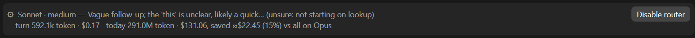

# claude-model-router

A local, private model router for [Claude Code](https://claude.com/claude-code). Every turn you start runs on the
cheapest Claude model that can do it well, and a meter compares its estimated cost with the same work tokens at
Opus prices, adjusted for cache switches and router overhead.

It does what [Jev](https://www.pulumi.com/blog/route-every-claude-code-message-to-the-right-model-with-jev/) and
`jev-router` do, with one difference that matters at work: **nothing leaves your Anthropic account.** Jev classifies
your messages on a third-party service (TypeSafe AI or OpenRouter); this router classifies them with Claude Haiku on
the same account Claude Code already uses. No proxy, no background service, no extra API key.
This is an independent project and is not affiliated with TypeSafe AI or Jev.

> **Requirements**
> Claude Code with function-hook plugins (the `register.tsx` hooks API), an early-access feature at the time of
> writing. Tested on Claude Code 2.1.295–2.1.308 on Windows. If your Claude Code does not support function hooks, the
> plugin installs but does nothing.



The screenshot is from an earlier version. The current band leads with the main context's estimated cost:

`Opus · ctx 221.0k · ≈$0.044/step │ cold resume ≈$1.77 · cache warm ~38m`

After the cache deadline it says what the next prompt would rewrite. Narrow terminals keep context and cold cost,
dropping routing detail first. The route and same-token Opus comparison follow when there is room. These are
API-equivalent estimates at the rates in `hooks/meter.ts`, not subscription charges. A resumed session without a
request timestamp shows an unknown cache deadline. Weekly subscription usage and its reset time (local time) come
directly from the engine's rate-limit windows; API-key sessions without a weekly window show none.

## How a turn is routed

| Tier | Model · effort | What lands here |
|------|----------------|-----------------|
| lookup | Haiku · medium | Retrieval and mechanical work with nothing to judge: find/grep/list, read a value or status, run a named command, rename, typo, format, short translation |
| execute | Sonnet · medium | Work whose "what" is settled in the message or visible context: a specified change, a bug with a known cause, tests, refactor to a stated target, docs from known material, explaining code, carrying out an agreed plan |
| decide | Opus · medium | Anything that needs judgment first: design, choosing between approaches, trade-offs, plans, unexplained failures, reviews, recommendations, ambiguous requests, working out how a change to business rules, production data or stored procedures should behave, porting to a branch whose code differs, anything irreversible or outward-facing |

1. **Classify.** When you send a prompt, Haiku (low effort, 8 s cap) sorts it with the last two messages as context.
   A short continuation ("yes", "继续") keeps the previous tier, a mix of tiers takes the highest, and when unsure it
   picks the higher tier. The classifier also says whether it is sure; **an unsure verdict never downgrades**: after a
   higher-tier turn the previous tier stays (shown as "unsure: not downgrading"), a first turn never starts on lookup
   (it runs on Sonnet), and an unsure `general-purpose` subagent lookup runs on Sonnet instead of Haiku. Likely secrets
   are masked before classification. **A failed classification never downgrades**: the turn keeps the previous turn's
   tier ("classifier failed (timeout): kept previous tier"), or, on a first turn with nothing to keep, is left unrouted
   on your own session model and effort ("classifier failed (...): session model"). The reason is one of `timeout`,
   `api-error <status>`, `empty-reply`, `unparseable` or `exception`, and `/model-router stats` counts them. An
   `unparseable` reply is logged with its first 120 characters (single line, masked) so the cause can be read in the
   events log; a reply cut off after the tier still parses, as an unsure verdict. In earlier versions a failure ran on Sonnet, and 24% of those turns later escalated to Opus (6% of classified turns did).
   `#haiku`, `#sonnet` or `#opus` in a message pins the model.
   **The classifier is skipped when it could not change the outcome.** If the last main request was Opus, is within the
   cache TTL and had a context of 50,000 tokens or more (see the round-trip guard, 4), the turn stays on Opus whatever
   the tier, so the prompt goes straight to Opus at the decide effort ("warm large context: classifier skipped") with no
   Haiku call; `/model-router stats` counts these. A `#model` pin still wins.
2. **Decide before working.** The model reads its assignment beside your prompt and must judge whether the task fits
   *before* doing any work. If not, it calls the `escalate` tool first: Haiku may move to Sonnet or Opus or raise its
   effort, Sonnet may move to Opus or raise its effort, Opus may set any effort. A move to a higher model lands at that
   tier's effort in the table (Sonnet medium, Opus medium) unless a higher effort is asked. Escalation only goes up within a turn.
   Effort-only escalation (same model, more effort) exists for the main thread and for subagents alike (a subagent's own effort is capped, see 6).
   **Opus picks its own effort.** Its assignment starts it at medium and says when to ask for more: medium for most
   work; high for multi-step design, plans or reviews; xhigh for hard debugging or architecture; max only for an
   irreversible, production-affecting decision or after an attempt at xhigh has failed. Max is the most expensive
   setting, so it is meant to be rare, and `/model-router stats` counts every escalation to max.
   **Opus plans, a subagent carries it out.** Once a plan is settled and carrying it out spans several files or many
   steps, the assignment tells Opus to delegate it to a general-purpose subagent without a model, which the classifier
   puts on Sonnet, and to verify the result. Small changes stay direct. Switching the main thread itself to Sonnet
   would rewrite its whole cache.
3. **Route every request.** Each model request of the turn runs on the route, keeping a context-window suffix such as `[1m]`.
4. **Never leave a warm cache for a cheaper model (the round-trip guard).** Switching to a smaller model makes it read
   the whole context uncached, and coming back to the bigger one rewrites that cache again. Real use showed this
   costing far more than the cheaper model saved: 19 times in four days a turn returned to Opus within the hour and
   rewrote 200k-800k tokens. So while the main thread's last request is within the cache TTL (1 hour) and its context
   is **50,000 tokens or more** (`WARM_CONTEXT_KEEP` in `hooks/meter.ts`), the router never moves the main thread to
   a lower model: it keeps the model that is warm (shown as `→ Opus (cache kept)`). Below 50,000 tokens the router
   still compares the two costs over the turn's expected steps and stays only if switching would cost more. Moving
   *up* is never blocked, and after the TTL the cache is cold, so a downgrade is allowed. An explicit `#model` pin
   always wins; leaving a warm large Opus context shows the estimated round-trip cache rewrite cost in the reason.
   Turns that start without a person prompt (a background task's notification, an agent message, a scheduled prompt)
   are never classified; while the previous route's cache is warm they **continue that route** ("continues previous
   route") instead of running on the session model. After the TTL, or with no previous route, they stay unrouted.
5. **Route subagents.** A subagent spawned without a model gets one by its job, decided when it starts:
   `Explore` runs on Haiku · medium; `general-purpose` is sorted by the same classifier (lookup → Haiku · medium,
   execute → Sonnet · medium, decide → inherits the parent's model, never a pinned Opus; if classification fails,
   Sonnet). An explicit effort on the Agent call is kept for both router and caller pins, subject to the hard cap
   of high. Otherwise router pins and caller pins to Haiku or Sonnet start at medium. A caller's Opus pin keeps the
   session's effort (also capped at high): medium is Opus's own self cap, so it could not raise itself from there. The caller's model is
   kept subject to the parent's tier; `inherit`, unknown ids and Fable keep their existing handling. The agent or the
   automatic ladder can raise effort later. `Plan` and named or custom agents declare or inherit their own model and are left alone, as are forks and
   workflow agents. A resumed agent keeps its tracked model, effort and error state without being classified or
   counted again. A subagent never runs above its parent's tier. A model the caller names is kept, except that it is
   capped at the parent's tier.
6. **Subagents can escalate, are escalated, and have a ceiling.** The same `escalate` tool works inside a subagent: it
   may raise its own model or effort from its next step, but on its own never above **Opus at medium** (haiku and
   sonnet may reach high; xhigh and max are cut down), and never above the parent's tier. A model change starts the new
   tier at medium, or at the asked effort if higher, whatever effort the old model had. Effort-only escalation on the
   same model only goes up. The router also escalates a failing subagent by itself, in two stages. After three tool
   errors in a row it first raises the effort one step on the same model (Haiku · medium → Haiku · high), and if three
   more follow at that tier it moves to the next model at medium (Haiku · high → Sonnet · medium), where the new model
   gets its own same-model retry. The whole ladder is haiku/medium, haiku/high, sonnet/medium, sonnet/high,
   opus/medium, then it stops (`SUBAGENT_SELF_CAP` and `SELF_EFFORT_CAP` in `hooks/subagent.ts`). An agent that
   inherits the session's effort counts as `high`. **At the ceiling the router raises nothing:** after three more tool
   errors it appends a note to that failing call's result ("You are at the subagent ceiling (opus/medium). Stop
   retrying: report what you found and what is blocking to the main conversation") and logs `ceiling reached`.
   **Only the main conversation can raise a subagent further:** it calls `escalate` with `agent` set to the subagent's
   id (as the Agent tool returned it), and the subagent is raised up-only to at most Opus at high, never above the
   parent's tier ("Subagent <id> now runs opus/high from its next step."; an unknown id gets "No tracked subagent
   <id>."; a subagent passing `agent` is refused). **Hard ceiling:** no tracked subagent request is ever sent above
   effort high, including agents that inherit the session's model and effort, so an xhigh or max session still
   sends them at high; xhigh and max are main-thread only. Forks and workflow agents are not capped by the router.
7. **Fable blocking (`blockFable`, on by default).** With it on, a subagent asking for Fable runs on Opus instead, a
   Fable parent never passes Fable down, and while main routing is on a Fable request on the main thread runs on Opus
   too. With `mainRouting` off the main model is your own choice and is left alone; only subagents are kept off Fable.
   With `blockFable` off nothing is rewritten for Fable, so you can run Fable as your main model and keep the other
   features; a subagent still never runs above its parent (its own cap stays Opus at medium, and main can raise it to Opus
   at high). Each block is counted once per turn on the main thread and once per subagent, not once per request.
   Optionally, set `reviewModel` to a model id available on your account and, if that model exists there
   (checked once a day), each Opus decision is reviewed by it and the review is added as a notice. **The reviewer is sent
   your request and Opus's answer unmasked.** The reviewer is off by default: with `reviewModel` empty the router makes
   no review call and no availability probe. Fable 5.1 is never used as the reviewer.
8. **Check the routing took effect.** After each request the router compares the model family that answered with the
   family it asked for; any difference is counted as a model mismatch in `/model-router stats`.
9. **Compaction guards (off by default).** Prompt caching uses a 1-hour TTL: resume a session after more than an hour
   idle and the next request rewrites the whole context into the cache at 2x input price. A 400k-token Opus context
   costs about $3.20 to rewrite, against about $0.08 to read while the cache is warm. Two options act on the main
   thread's context, tracked for every model family including Fable:
   - `idleCompactMinutes` (1 to 55): after that many idle minutes at the prompt the router calls `/compact` itself,
     while the cache is still warm, so the eventual rewrite is of a summary, not the whole context. It runs only if
     freshest measured main context is at least `compactMinContext` (default 100,000 tokens), the last main request
     is still at least 3 minutes inside the cache TTL, and no subagent or teammate is pending, running or waiting. If one is,
     the router checks once more after 5 minutes, or at the safe deadline if that is earlier, and otherwise skips.
     A long final response brings the idle timer forward to that deadline, measured from when its request was sent,
     leaving a 3-minute cache margin plus 30 seconds of scheduling headroom.
     It always leaves at least 1 minute at the prompt; if that would pass the deadline, it does not arm.
     Any new prompt or turn cancels the timer, so a person who comes back is never compacted under; so does turning
     the router off. Values outside 1 to 55 count as off (not clamped): 56 or more cannot fire safely inside the
     cache window.
   - `compactAtContext` (tokens, e.g. 200000): when a main turn ends with the context at or above this figure it is
     compacted between turns, while the cache is warm, so later steps do not each re-read a huge cache. A value
     below 100,000 counts as off (the engine's own auto-compact window starts there). If the compaction is refused
     because the turn still counts as running, it is retried up to 3 times, 2 seconds apart; if it never lands the
     idle guard (if set) takes over. Busy agents defer it to the idle guard too. Aborted turns arm only the idle guard.

   After any compaction (this plugin's, a manual `/compact`, or the engine's auto-compact) the router forgets its
   cached context figure, cancels any pending compaction, and stops treating the cache as warm for model switching.
   A `precompute` only prepares a summary and leaves that state and any pending timer alone.
   A compaction another plugin vetoes, or one refused because a turn is running, is not counted; a guard that cannot
   continue reports the reason once in a toast.
   Each compaction that happens shows a one-line toast with the size compacted (before and after, when the engine
   reports both). `/model-router stats` counts idle, cap and checkpoint compactions separately, and also counts **cache rewrites after the TTL** (a main
   request after a gap over an hour, or the first request after `claude --resume`, that wrote 100k or more tokens of
   cache, with writes outweighing reads) with what those writes cost, whether or not a guard is on, so you can see what the
   guard would save.

## Task-boundary checkpoints

Run `/model-router checkpoint [note]` between tasks to compact now, keeping the goal, constraints and rules,
decisions and their reasons, unresolved findings and questions, next steps, and the paths, commands and IDs needed
to continue. The optional note is passed to the summariser. It refuses a running main turn or busy agents. The host
requires compaction outside the command hook, so an accepted checkpoint runs on the next clock tick, rechecking
agents; a new prompt or switching off cancels it. It never waits for active work to finish. Explicit checkpoints
also work with routing off. The completion toast shows before → after when available; stats count checkpoints
separately from idle and cap compactions.

`checkpointHints` is **off by default**. When enabled, a completed main turn can suggest a checkpoint if the freshest
context is at least `compactMinContext` and estimated read savings over 15 future steps exceed one cached read of the
current context, 8k summariser output tokens and a 40k-token summary cache write. These are assumptions at the last
observed model's prices. A hint never compacts anything. After one, another needs 50% context growth or 30 minutes;
aborted turns and a context cap that will compact do not hint.

## Large logs and progress output

`shrinkToolOutput` is **off by default** (`0`); values outside 20,000–1,000,000 characters also count as off. When enabled, large
Bash and MCP logs and progress output are reduced only after archiving the original verbatim under
`<logDir>/outputs/<sessionId>/<tool_use_id>.txt`, beside the events log. A failed archive write leaves the output
unchanged. The engine limits filesystem reads and writes to 4 MiB, so outputs beyond that limit also pass through.
Archives remain local, contain the exact unmasked output, and are not automatically pruned.

The reducer handles only output with at least two thirds of its nonblank lines recognised as logs/progress.
It removes ANSI escapes and carriage-return progress redraws and collapses consecutive recognised log/progress
lines differing solely in a leading timestamp or progress field, showing the first and last state; numbers, IDs and hashes in messages stay distinct. Only output with at least two thirds of its
nonblank lines recognised as logs/progress can be truncated to the beginning, end and every
error/warning/fail/exception/traceback block, including stack frames and continuation lines, with omission counts. Diagnostics take priority even when they exceed
the threshold. Unclassified lines are also preserved. Other output, such as SQL, CSV, JSON, file listings and prose,
passes through unchanged, including identical repeated lines. Read, Edit, Write,
Grep and Glob are excluded; a conservative content check also leaves code and diffs alone. Media results are left alone.

The reduced result names its archive and `mcp__model-router__fetch_output`. This tool is registered only when the
option is enabled. Pass `id` (the tool-use id), optionally `startLine` / `endLine` (1-based, inclusive) or `pattern`
(a literal, case-insensitive grep). Returned slices retain the original text and line endings. Each call is capped
at `shrinkToolOutput` characters, including continuation instructions; use the returned `offset` with the same
selection to page through long lines without losing characters. Stats count reductions and characters removed.

## Events log

The router writes new JSON batches to `~/.claude/model-router/<sessionId>/<writerId>-<sequence>_<timestamp>_<attempt>.json` (the `.claude`
directory is the one the plugin is installed under). Each activation owns its filenames; events have unique ids,
and stats are deltas for that batch. Reading merges all batches by time, deduplicates ids, and sums the stats.
The timestamp is Unix time in milliseconds; the attempt number increases on every write, including retries.
Legacy `events-<sessionId>.json` files are still read, never rewritten or deleted. Individual timestamped batches
older than 30 days are pruned, including those in active sessions; empty batch directories are then removed.
Untimestamped batches are kept. Logs stay on your machine for your own analysis; writing is best effort and
never affects a turn. Only unsaved batches stay in memory.

```
{
  "id": "<writerId>-<sequence>",
  "sessionId": "...",
  "events": [{ "id": "<writerId>-<sequence>", "at": "<ISO time>", "agentId": "...", "event": "...", "to": "...", "reason": "..." }],
  "stats": {
    "<agentId>": {
      "byModel": { "<modelId>": { "steps": 0, "input": 0, "output": 0, "cacheRead": 0, "cacheWrite": 0 } },
      "byEffort": { "<effort>": 0 }
    }
  }
}
```

`event` is one of: `turn route` (agent `main`, the route chosen for a turn), `turn inherit` (agent `main`, a turn without
a person prompt that continued the previous route), `<subagentType> start` (a subagent
started, for example `Explore start`), `escalated` (a subagent raised its own model or effort), `raised by main` (the main conversation raised it), `auto-escalated`
(the router raised it after repeated tool errors), `ceiling reached` (three more errors at the subagent ceiling), and
`compact idle` / `compact cap` / `compact checkpoint` (agent `main`: a compaction attempt; `to` is `done`, `skipped` or `rejected`, `reason` the
size before → after, the veto or the engine error). `byEffort` counts steps per effort; `default` means the session's
own effort. `stats` covers routed subagents only.

## Privacy

- **Where classification runs.** On Claude Haiku, through the same Anthropic account Claude Code already uses: no third
  party, no proxy, no extra key.
- **What the classifier receives.** The new message, capped at 6,000 characters, plus the last two non-empty messages of
  the conversation (each trimmed to its first 200 and last 1,000 characters when longer than 1,200). All three are
  masked by `hooks/redact.ts` before they are sent (context messages before trimming): private-key blocks, Anthropic and OpenAI-style keys, GitHub, Slack and
  Telegram tokens, AWS and Google API keys, JSON web tokens, `Bearer` tokens, 64-character hex strings, and values
  assigned to names containing `api_key`, `secret`, `token`, `password` or `pwd`. This is pattern matching and will not
  catch every secret.
- **Subagents.** When a `general-purpose` subagent is started without a model, its prompt (masked and capped the same
  way, without the conversation context) goes to the classifier.
- **Nothing else is collected.** No telemetry and no analytics. The router makes no network call of its own: the only
  traffic is the Anthropic API calls Claude Code makes, now including the router's Haiku calls. The meter totals and
  the events log are written to local files only.
- **Optional reviewer (off by default).** If you set `reviewModel`, each Opus decision is sent to that model after the
  turn: your request (first 6,000 characters) and the last 12,000 characters of Opus's answer, not masked. Once a day it
  also sends a one-word probe to check the model exists. With `reviewModel` empty, none of this happens.

## Cost comparison and commands

Every model request (the router's own Haiku calls included) is priced at Anthropic API rates and added to the turn,
the day and the retained totals. The baseline prices the same tokens on Opus 5.5. The band shows this turn and today;
`/model-router stats` first names whether the router is on and the compaction settings loaded by the plugin: idle
minutes, context cap and `compactMinContext`. It then shows this session and today across sessions by main /
subagents / classifier / reviewer / compaction and by cache reads / cache writes / uncached input / output.
It also shows recorded compaction sizes, cold rewrites and peak main context. The band and stats label the comparison
as a **difference**: another model would not necessarily use the same tokens. Older records without these categories
are labelled as unattributed spend. The retained total covers 30 days plus legacy totals. Stats also show turns per
tier, escalations, warm-cache keeps, classifier calls skipped, routed subagents, Fable requests moved to Opus,
model mismatches (routed model not the one that answered),
classifier failures by reason and escalations to max effort (main thread only, counted when effort moves to
max from below).

This is an estimate; see "Assumptions in the meter" below.

| Command | What it shows |
|---------|---------------|
| `/model-router stats` | Router on/off and loaded idle/cap/minimum-context settings, session and daily spend, the same-token comparison and counters (also the default command) |
| `/model-router status` | Router on/off, every loaded option including idle/cap/`compactMinContext`, pending guard timer, cache and safe compaction deadlines, weekly window and last skipped action |
| `/model-router checkpoint [note]` | Compact between tasks, preserving the information needed to continue |
| `/model-router context` | Main context size and local category estimates, or an explicit unavailable message; makes no token-count requests |
| `/model-router on` / `/model-router off` | Enable or disable routing and guards |

With no argument, `/model-router` shows stats. Other arguments, including `help`, show the usage line.
The engine's `/compact` also works; it is separate from the router's commands.

The status line shows weekly subscription usage and the reset time in your local timezone when the engine supplies
a weekly window, alongside the latest subagent event status. A pending guard temporarily takes that event slot.
For example, with an idle guard enabled:

`Weekly 76% · resets Fri 18:00 │ idle compact in 12m`

An idle countdown becomes a busy-agent count when agents defer compaction. The pending guard text clears when the
action ends or is cancelled, restoring the latest subagent event; weekly usage remains. API-key sessions without a weekly window omit that part.
A skipped action gives one toast per armed timer; a successful compaction reports before → after sizes when the
engine supplies them.

## Install

Requires Claude Code with function-hook plugins (early access; tested on 2.1.295–2.1.308). In a terminal session:

```
/plugin install model-router --marketplace hhchuan89/claude-model-router
```

Answer `y` to add the marketplace and pick a scope. Installed at user scope it also loads in Claude Code Desktop.
**Disable router** in the band, or `/model-router off`, leaves every request on the session's model. To keep subagent routing
but leave your own conversation alone, turn `mainRouting` off instead (see Options).

## Options

Changing an option reloads the plugin. Use `/model-router stats` or `/model-router status` to confirm the loaded
values, including router on/off, idle minutes, the context cap and `compactMinContext`.

| Option | Default | Range | Meaning |
|--------|---------|-------|---------|
| `language` | `en` | `en`, `zh` | Language of the UI, routing reason and price comparison (English or Simplified Chinese) |
| `mainRouting` | `true` (on) | `true`, `false` | On: classify and route the turns you start, except when the warm-cache guard makes classification unnecessary. Off: **subagent-only mode, the low-risk way to start.** The main thread keeps your session model and effort, with no classification or assignment text, while subagent routing, escalation, Fable blocking for subagents and the meter keep working |
| `blockFable` | `true` (on) | `true`, `false` | On: Fable never runs on a subagent, or on the main thread while `mainRouting` is on (those requests run on the Decision model); with `mainRouting` off your main model is left alone. Off: Fable is left alone everywhere; a subagent still never runs above its parent |
| `haikuModel` | `claude-haiku-5-5` | Model-id string | Lookup model id available on your account |
| `sonnetModel` | `claude-sonnet-5-5` | Model-id string | Execution model id available on your account |
| `opusModel` | `claude-opus-5-5` | Model-id string | Decision model id available on your account |
| `reviewModel` | `""` (off) | Empty string or a model id available on your account | Review Opus decisions only if the model exists there; Fable 5.1 is never used. **The reviewer is sent your request and Opus's answer unmasked** (see Privacy) |
| `idleCompactMinutes` | `0` (off) | 0–55 minutes; active at 1–55 | Compact the main conversation after this many idle minutes, while the cache is warm, context is at least `compactMinContext` and no background agent is busy. A new prompt cancels it. Values outside 1–55 count as off |
| `compactMinContext` | `100000` | Tokens ≥ 0; no configured maximum | Minimum context for idle compaction and checkpoint hints (a small context is cheap to rewrite) |
| `checkpointHints` | `false` (off) | `true`, `false` | Suggest a task-boundary checkpoint when estimated savings exceed its cost; never compacts automatically |
| `shrinkToolOutput` | `0` (off) | 0–1,000,000 characters; active at 20,000–1,000,000 | Reduce large Bash/MCP logs and progress output, archive originals and fetch capped slices. Values outside the active range count as off |
| `compactAtContext` | `0` (off) | Tokens ≥ 0; active at ≥ 100,000; no configured maximum | Compact between turns when main context reaches this size (e.g. `200000`), so every step does not re-read a huge cache. Below `100000` counts as off |

`checkpointHints` and `shrinkToolOutput` require opt-in. Existing option defaults are unchanged in 1.0.0.

## Assumptions in the meter

The dollar figures are **estimates**, computed from the price table in `hooks/meter.ts` (Anthropic first-party API
rates, as of 2026-10). They may differ from your actual pricing or plan: on a subscription you pay in usage limits, not
dollars, and another model would not have used exactly the same tokens. The dollar difference and percentage are
same-token comparisons, not measured savings.

Classification and reviewer availability probes are overhead: they add actual cost without an Opus baseline credit.
The plugin's own compactions are metered when the engine reports usage. That usage has no model id, so their cost
is estimated at the last main request's model rates. Missing usage cannot be priced.

Daily tallies and counters are stored separately per session so concurrent sessions cannot overwrite each other's
increments. Records are kept for 30 calendar days. Stats aggregate those records and continue reading older versions'
daily and all-time totals unchanged; the retained total includes the legacy all-time figure once. Legacy baseline
figures cannot be corrected retrospectively because they do not separate classifier usage.

Prices per million tokens in the table: Opus 5.5 $4 in / $20 out, Sonnet 5.5 $2 / $10, Haiku 5.5 $0.10 / $0.50; cache
reads $0.20 (Haiku assumed at 10% of input); cache writes at 2× input (Claude Code's 1-hour cache TTL). Change
`hooks/meter.ts` if your rates differ.

**The baseline is switch-aware.** When a main-thread request changes model family within the cache TTL (down to a
cheaper model, or back up to Opus), its cache writes exist only because of the switch: staying on Opus all along would
have read that context from a warm cache. The baseline therefore prices those cache-write tokens at Opus's cache-read
rate, not its write rate, so a round trip no longer shows a saving that was not there. The actual cost is unchanged.

## Development

```
claude plugin validate .
claude plugin test .
```

## Contributors

See [CONTRIBUTORS.md](CONTRIBUTORS.md).

## License

MIT
